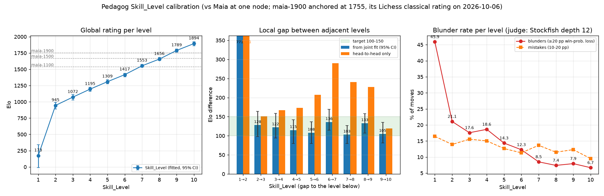

# COLOPHON

## Who wrote this

Written by **Claude Fable 5.1** (model id `claude-fable-5.1`), running as the
GitHub Copilot CLI agent (version 1.0.83), on 2026-10-06.

- **Part I** (the engine): 09:43 to about 11:45 US Central time — roughly two
  hours wall-clock, well over half of it spent playing calibration matches.
- **Part II** (skill levels, measurements, web app): 12:49 to about 14:45 —
  roughly two hours, about half of it match time (some 50,000 games).

The harness does not expose exact token counts. Estimated from the session:
Part I roughly 220,000 tokens of context (prompts, files read, tool output)
and 100,000 generated, including three complete versions of `pedagog.js`;
Part II roughly 250,000 tokens of context and 90,000 generated. Call it
half a million tokens in all.

## Part II — Skill levels

### What a level is

Below full strength the engine is weakened the way Gaia does it, with the
knobs that were measured to matter (section S2 of `pedagog.js`):

| knob | what it does | measured at depth 2, vs the same depth unhandicapped |
|---|---|---|
| **depth** + extra-ply share | how far it looks; one extra ply on a hash-chosen share of positions, so a rung can sit between two whole depths | d1→d2 ≈ +500, d2→d3 ≈ +240, d3→d4 ≈ +180, d4→d5 ≈ +150; half-ply mixes land mid-way |
| **vision** (/1024) | chance a move is considered at all; captures and checks get two chances; fades 16/ply to a floor of 160 | 900 → −69, 800 → −203, 700 → −330, 600 → −413 |
| **blunder** | on a hash-chosen share of positions the evaluation is off by up to ±window cp | 400 cp at 5 / 10 / 20 % → −60 / −125 / −191 |

Gaia's other two mechanisms were measured and dropped: a *small error on
every position* was worth nothing until ≥150 cp (−65), and *evaluation
fidelity* (blending towards material-only) was worth nothing at all
(+10 ±44 at half fidelity, −4 ±41 at material-only) — this piece-square table
is simply not worth much against Maia at depth 2. Everything is drawn from
the position hash and `Skill_Seed`, so a level is the same opponent on any
machine; levels 2–9 are depth-bounded and ignore the clock entirely. Level 1
plays a random legal move but always mates in one; **no other level has a
mate-in-one safety net** — a weak level can miss or allow one, like a weak
player. At full strength nothing is randomised, so `Skill_Seed` has no effect
there (as in Gaia; variety comes from the opening book).

### The ladder, as measured

Method: every level played 300 games against the level below and 300 against
each of Maia-1100 and Maia-1900 (some also Maia-1500), level 10 at 10+0.1,
all others depth-bounded; `tools/elo.js` fits one rating to all results
(Elo logistic model, draws as half points) with bootstrap intervals. The
scale is anchored on **Maia-1900 = 1755**, the Lichess classical rating of
the bot that runs that network (`maia9`: 1755, RD 45, 141,012 games on
2026-10-06), so the numbers below read as Lichess classical ratings. Nine
tuning rounds; the final data are in `docs/skill-curve.json`. Note that the
three Maias span only ~220 Elo against engines (1538 / 1670 / 1755 here),
whatever their training labels say.

| level | depth | +1 ply share | blunder | vision | **Elo** (95 %) | gap to level below (fit) | head-to-head |
|---|---|---|---|---|---|---|---|
| 1 | random mover, mates in one | | | | **173** [−11, 340] | — | — |
| 2 | 2 | 10 % | 500 cp @ 4.5 % | 860 | **945** [890, 993] | 771 | 771 |
| 3 | 2 | 20 % | 450 cp @ 4.0 % | 910 | **1072** [1028, 1111] | 128 | 151 |
| 4 | 2 | 40 % | 400 cp @ 3.5 % | 945 | **1195** [1162, 1224] | 122 | 167 |
| 5 | 2 | 65 % | 400 cp @ 2.5 % | 967 | **1309** [1278, 1338] | 115 | 173 |
| 6 | 3 | — | 350 cp @ 2.0 % | 980 | **1417** [1382, 1439] | 108 | 207 |
| 7 | 3 | 65 % | 300 cp @ 1.5 % | 1000 | **1553** [1529, 1576] | 136 | 290 |
| 8 | 4 | 5 % | — | full | **1656** [1636, 1680] | 103 | 241 |
| 9 | 4 | 60 % | — | full | **1789** [1762, 1813] | 133 | 228 |
| 10 | full strength (clock) | | — | full | **1894** [1858, 1921] | 105 | 119 |

All eight gaps between levels 2 and 10 fall in the requested 100–150 band on
the joint fit (the "global" scale). Head-to-head gaps between adjacent levels
(the "local" measure) are systematically larger — two engines with the same
blind spots exaggerate their difference — which is why the ladder was tuned
on the joint fit. The top is structurally tight: pure depth 5 is already full
strength here, so levels 7–10 have to share about 340 Elo. (The ladder was
tuned with Maia-1900 anchored at its nominal 1900; re-anchoring to 1755 only
shifts every rating by −145 and changes no gap.)

### Blunder rate

Judge: Stockfish 19 at depth 12 (`tools/blunders.py`), on 80 games per level
drawn from the calibration matches. Assumptions: centipawns → win probability
by Lichess's formula; a **blunder** costs ≥ 20 percentage points, a
**mistake** 10–20; positions already beyond ±600 cp are not counted (a lost
side's blunders are meaningless, a won side's harmless); only the level's own
moves are judged, and book moves are not in the record.

| level | 1 | 2 | 3 | 4 | 5 | 6 | 7 | 8 | 9 | 10 |
|---|---|---|---|---|---|---|---|---|---|---|
| blunders | 45.9 % | 21.1 % | 17.6 % | 18.6 % | 14.3 % | 12.3 % | 8.5 % | 7.4 % | 7.9 % | 6.7 % |
| mistakes | 16.5 % | 13.9 % | 15.6 % | 15.0 % | 12.6 % | 11.3 % | 13.7 % | 11.5 % | 12.3 % | 9.5 % |
| mean loss / move | 23.5 pp | 11.6 | 10.9 | 10.8 | 8.4 | 7.6 | 6.5 | 5.7 | 5.8 | 5.1 |

Even full strength blunders on 6.7 % of its moves by this yardstick: that is
the horizon effect of a search without quiescence, and the next chapter.

### The web app

`index.html` + `web/`: chessground for the board, cm-chess for legality
(including Chess960 castling), the engine in a Web Worker. Human vs bot or
bot vs bot, a level per bot, standard or Chess960 (position 0–959 or random,
selector shown only for that variant), move list, captured pieces with
material balance, elapsed time per side (never enforced), "Open in Lichess"
at any moment (PGN with `[Variant]`/`[FEN]` tags), copy PGN. Serve it with
`bun run web` (or any static host); a service worker caches everything so it
keeps working offline and can be installed on a phone. Bot time is fixed:
levels 1–9 are depth-bounded and answer in milliseconds, level 10 thinks for
one second. Vendored: chessground 9.2.1 (GPL-3.0-or-later), cm-chess 4.0.1
(MIT), cm-pgn 5.0.1 (MIT), chess.mjs 2.4.2 (BSD-2). The web app is therefore
GPL-3; the engine file is independent of it.

### Tools

`tools/match.js` (cutechess wrapper: `bun run match L7 maia-1500 300`),
`tools/elo.js` (joint Elo fit), `tools/blunders.py` (Stockfish judge),
`tools/plot.py` (the figure), `tools/serve.js` (static server with the
cross-origin-isolation headers). Match PGNs land in `tools/out/` (ignored).

### The Part II brief

> # Part II
> 1. Add a Skill_Level UCI option; It should have N levels where N <= 10 (to be determined in tuning). Level N is full strength; each level below is 100--150 Elo weaker, except for level 1; Level 1 is a random player but always finds mate-in-1. Use the four knobs that Gaia uses to limit strength (https://github.com/jromang/gaiachess/blob/main/src/skill.rs).
> 2. Measure the skill curve of Skill_Level vs Elo, and Elo difference of adjacent Skill_Levels i.e. global and local Elo ratings. Plot them on graphs in a single image.
> 3. Estimate the blunder rate per Skill_Level using reasonable assumptions. Plot that as well.
> 4. Create offline, mobile-friendly index.html page that uses the engine, chessground to display the board, and cm-chess for client-side validation of moves. Should allow human vs bot, and bot v bot play. Allow selecting the bot strength. Show moves played and allow viewing the game in lichess at any point during a game. Show time elapsed but do not enforce any limits; do NOT add options for setting the bot's time usage. Allow selecting chess960 startpositions, including at random; only show the chess960 startpos selector when that variant selected. Show pieces captured by each player.
>
> Let's review design before you start

Follow-up decisions during Part II:

> Approved, but mate-in-1 only at level 1
>
> FYI the limited engine should be capable of blundering mate-in-1 at any level except full strength. Please continue

> Before starting a long-run. Recommend the knobs that actually make a diffrence
>
> Drop fidelity AND the small error; keep depth, vision, blunder only

## Part I — How strong it is, and how that was measured

The brief asked for an engine as strong as Maia-1900 but no more than 200 Elo
stronger, simplifying the search until it fits. Maia-1900 is the Lc0 network
trained to play like a 1900-rated human (CSSLab, `maia-1900.pb.gz`), run at
one node per move, as it is meant to be.

Matches were played with cutechess-cli: Pedagog at **10 s + 0.1 s** against
Maia on lc0 v0.32.1 (BLAS backend, `nodes=1`), from the OpenBench
`8moves_v3.epd` book with each opening played from both sides, resign
(3 moves at ±600 cp, both sides agreeing) and draw (after move 40, 8 moves
within ±10 cp) adjudication, 250-move limit. Elo differences are head-to-head
against this one opponent, not CCRL ratings; "±" is the 95% interval printed
by cutechess.

The engine was first written with the usual full toolkit, then features were
switched off one group at a time and measured:

| configuration | score | Elo vs Maia-1900 | games |
|---|---|---|---|
| full: TT, PVS, aspiration, null move, reverse futility, LMR, killers, history, check extension, quiescence with delta pruning | 98.8% | +759 | 40 |
| ID + alpha-beta + quiescence + MVV-LVA + TT (no pruning, no aspiration) | 86.3% | +319 ±142 | 40 |
| ID + alpha-beta + quiescence + MVV-LVA | 88.7% | +359 ±69 | 200 |
| ID + alpha-beta + quiescence + captures-first | 79.7% | +238 ±55 | 200 |
| ID + alpha-beta + quiescence, no ordering | 69.0% | +139 ±47 | 200 |
| ID + alpha-beta + MVV-LVA, no quiescence | 76.0% | +201 ±38 | 313 |
| ID + alpha-beta + captures-first, no quiescence | 75.0% | +191 ±47 | 200 |
| ID + alpha-beta only (no ordering, no quiescence) | 50.2% | +2 ±42 | 200 |
| **ID + alpha-beta + captures-first, evaluation recomputed at every leaf (this file)** | **66.2%** | **+117 ±47** | 200 |

(ID = iterative deepening. The 40-game rows have very wide intervals and are
kept only to show the order of magnitude. All rows but the last use an
incrementally updated evaluation, about 1.6x faster than the loop in this
file.)

How the final choice was reached:

- *No move ordering, with quiescence* (+139) was rejected because an
  unordered quiescence search explodes in tactical positions — on the
  Kiwipete position it cannot finish depth 3. In games the clock hides this;
  for `go depth N` it is unusable.
- *MVV-LVA without quiescence* measured +129 ±45 in a first 200-game run that
  shared the CPU with another match, then +201 ±38 over 313 games run alone,
  i.e. right on the ceiling.
- *Captures-first without quiescence* measured the same +191 ±47: without a
  quiescence search, ranking the captures buys nothing.
- *Alpha-beta alone* lands exactly on Maia-1900 (+2 ±42), the floor of the
  window; captures-first ordering alone is worth about +190 here.
- Keeping captures-first and dropping the incremental evaluation (the sums
  are recomputed by walking the board at each leaf, which is simpler to read
  and about 1.6x slower) gives **+117 ±47**, in the middle of the window.
  That is this file.

Read as a ladder, the table says what the next chapters are worth at this
level: incremental evaluation about +70 (speed), a quiescence search about
+50 on top of captures-first (and +100 more once captures are ranked by
victim — the two belong together), a transposition table about +100 more,
and the pruning family (null move, reverse futility, LMR, aspiration, PVS)
roughly +400 on top of all that.

`Hash` is accepted but does nothing, since there is no table yet. The
8-centipawn Skill_Seed noise of Part I was present in every Part I match; it
was removed in Part II (measured worthless), so level 10 is now fully
deterministic.

### What was deliberately left out

Transposition table, principal variation search, aspiration windows, null
move pruning, reverse futility pruning, late move reductions, killer and
history heuristics, check extension, quiescence search, delta pruning,
MVV-LVA capture ranking and incremental evaluation. All of them were written,
tested and then removed; the table above is what they cost. The evaluation is
formula-based piece-square tables — the brief said to try a naive PSQT first
and PeSTO only if the engine turned out too weak, and it did not.

## Files

- `pedagog.js` — the engine, one file, read top to bottom.
- `index.html`, `web/`, `sw.js` — the web app (Part II); `bun run web` serves it.
- `tools/` — match runner, Elo fit, blunder judge, plot, server.
- `docs/` — `skill-curve.png`, `skill-curve.json`, `blunders.json`.
- `package.json` — `bun start`, `bun run bench`, `bun run perft`, `bun run web`.

Verification done during the session: perft to depth 4–5 on six standard
positions and eight Chess960 positions (all 58 node counts correct, ~10 M
nps); mate-in-1 positions; MultiPV; `go infinite` + `stop`; `isready` during
search; both castling notations on input; the Web Worker path in headless
Chrome; Skill_Seed reproducibility (same seed → identical node count and PV,
different seed → different search); the web app driven end to end in headless
Chrome (bot vs bot in Chess960, a human move and an illegal one, PGN tags).

## The Part I brief

The task, verbatim:

> # Part I
> Write a single-file, UCI chess engine in javascript,
> 1. which can run in Bun or the browser,
> 2. that supports UCI_Chess960 option
> 3. Add a MultiPV option
> 4. Add "Skill_Seed" UCI option like in Gaia (https://github.com/jromang/gaiachess) to make the engine deterministic
> 5. Add other UCI commands and options to support OpenBench (e.g. Hash, Threads) but keep the engine single-threaded always
> 6. No other UCI options for now
> 7. Engine must be as strong but no more than 200 Elo stronger than Maia1900; if the engine is stronger, simplify search techniques until it falls in the range (this is to make the source code pedagogical).
> 8. Refactor only the engine for readability, like in Chal (https://github.com/namanthanki/chal/blob/main/src/chal.c); ensure the UCI options are located near to the string "uciok" in the source code; also put the Search functions as close to the top as possible so that, like a good book, the most interesting part of the engine is read first.
> 9. In COLOPHON say what model was used and how many tokens, how long the entire process took, and include this entire prompt.

Follow-up instructions given during the session:

> Try using naiva psqt and then use Pesto if its not good enough

> It is OK for the Hash to be a noop for now. We might add it later when adding Skill Levels. I just need a base engine which is as simple as possible first.
>
> Would removing aspiration windows, pruning, TT reduce the strength to the required level? Those sections seem confusing so I'd be happy to lose them

> Don't stop what you're doing. Will using fastchess speed your testing significantly, or is it only faster for SPRT, or sthg else?

> Move COLOPHON to COLOPHON.md. Keep doing what you're doing

## Acknowledgements

The 0x88 board, pseudo-legal generation with legality by make/unmake,
Zobrist hashing and negamax alpha-beta are the common property of the chess
programming community (chessprogramming.org). The layout follows
[Chal](https://github.com/namanthanki/chal) by Naman Thanki; the Skill Seed
idea and the skill-level mechanisms follow
[Gaia](https://github.com/jromang/gaiachess) by Jean-François Romang and
David Rabel. Chess960 perft positions are from the FRC perft suite as
distributed with Ethereal. Maia is by the CSSLab at the University of
Toronto; lc0 by the LCZero authors; cutechess by Ilari Pihlajisto and Arto
Jonsson; the opening book is from OpenBench by Andrew Grant; Stockfish by the
Stockfish developers judged the blunders; chessground is by the lichess.org
developers, cm-chess, cm-pgn by Stefan Haack, chess.mjs by Jeff Hlywa and
contributors.
