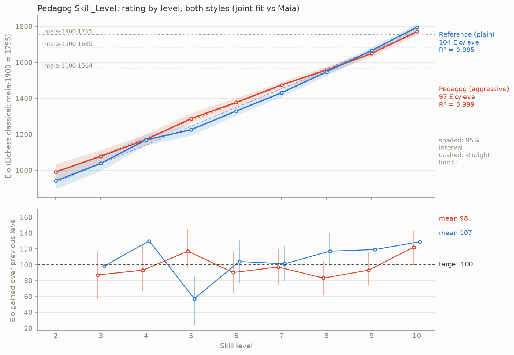
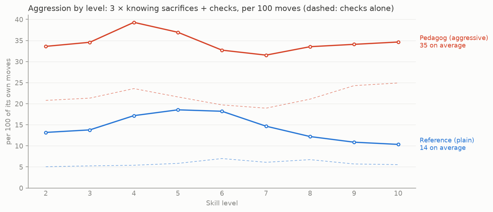

# COLOPHON

## Who wrote this

Written by **Claude Fable 5.1** (model id `claude-fable-5.1`), running as the
GitHub Copilot CLI agent (version 1.0.83), on 2026-10-06.

- **Part I** (the engine): 09:43 to about 11:45 US Central time — roughly two
  hours wall-clock, well over half of it spent playing calibration matches.
- **Part II** (skill levels, measurements, web app): 12:49 to about 14:45 —
  roughly two hours, about half of it match time (some 50,000 games).

The harness does not expose exact token counts. Estimated from the session:
Part I roughly 220,000 tokens of context (prompts, files read, tool output)
and 100,000 generated, including three complete versions of the engine (then `pedagog.js`, later `engine.js`, now `engine.ts`);
Part II roughly 250,000 tokens of context and 90,000 generated. Call it
half a million tokens in all.

**Part III** (functional refactor, aggressive style, two ladders, Mystery mode)
was written by **Claude Opus 5.5** (model id `claude-opus-5.5`), running as the
GitHub Copilot CLI agent (version 1.0.96), from 2026-11-10 13:00 to about
2026-11-11 03:00 US Central — most of it match time, well over 100,000 games.
The harness does not expose token counts; the session was long enough to be
summarised (compacted) along the way.

## Part III — An aggressive style

### What changed

The engine was first refactored without changing its play: every function
takes its inputs and returns its results (no shared mutable state), positions
became immutable values made by copy/make, with a single summed 46-bit key, and
time management kept a one-second clock reserve. Then the brief changed:
make Pedagog *feel* aggressive — sacrifices, checks, pieces swarming the king —
while staying as strong as Maia-1900 at the top level.

The style is three numbers (`Style` in `engine.ts`, applied in `evaluate()`
and at the root of the search):

| knob | aggressive | plain | what it does |
|---|---|---|---|
| `kingAttack` | 60 | 0 | middlegame bonus per square that a knight, bishop, rook or queen (queen ×2) stands closer to the enemy king |
| `materialMg` | 250 ‰ | 1000 ‰ | middlegame material counts this share of its value, so giving it up for an attack costs less |
| `checkBias` | 60 cp | 0 | at the root, a checking move counts this much better (mate scores excepted) |

Both styles also gained a short **quiescence search** (captures only, MVV-LVA
ordered, at most four plies past a leaf) and better move ordering (the previous
iteration's best move first, then MVV-LVA captures). Without quiescence the
aggressive style's sacrifices are hopes rather than calculations; with it, a
sacrifice that loses to a simple recapture is seen as such.

### How aggression was measured

`tools/style.py` reads cutechess PGNs and reports, per 100 of a player's own
moves: **knowing sacrifices** (its material balance drops by ≥ 2 pawns and
stays down a move later, while its own evaluation of the move was ≥ −0.5),
**blunders** (the same drop when its evaluation already said it was losing),
**checks**, middlegame **king distance** of its pieces, material imbalance and
evaluation swings. The single **aggression score** is 3 × sacrifices +
checks. As a sanity check the metric ranks full-strength Patricia 5.1 (a
deliberately aggressive engine; checks 14.3, sacrifices 2.5) above
full-strength Stockfish 19 (7.6, 1.7). Engines weakened to ~1900 (Stockfish
`UCI_Elo` 1500, Patricia skill 7) look *less* aggressive, not more: their
weakening adds blunders, not attacks.

### What the knobs cost

At level 10, 10+0.1, 200 games each against Maia-1900 (± ≈ 45), all with
quiescence: `kingAttack`/`materialMg` 40/300 ≈ +80, 60/250 ≈ 0, 90/200 ≈ −90,
120/150 ≈ −130 — a cliff past 60/250, while knowing sacrifices rose from
2.4 to 5.3 per 100 moves (Maia: ~2.1). A root check bonus of 0 / 30 / 60 cp
cost about 7 Elo per step (−40, −47, −54) and raised the aggression score
19.1 / 21.5 / 23.2. Contempt and three further style terms (development, early
queen, space) were tried and dropped as not worth their lines.

At equal search settings the plain style beats the aggressive one by about
**210 Elo** head-to-head at every level: that is the price of the style. So each
style has its own ladder, and an aggressive level searches a little deeper
and errs less than the plain level with the same number.

### Search speed

Quiescence made the aggressive search 8–30× more expensive (87 % of its nodes
were quiescence nodes). Two simple changes paid for it: trying the previous
best move and ranking captures in the main search cut nodes about 2.7×, and
capping quiescence at four capture plies cut depth 5 from 2.9 s to 0.37 s per
move. The cap costs little at a fixed depth (−42 ± 66 against no cap; a cap
of two cost −104 ± 65), and the depth it buys is worth far more (capped depth
5 beat uncapped depth 4 by +235 ± 54).

### Two depth-bounded ladders

Level 10 no longer plays on the clock: every level is a depth (with an extra
ply on a hash-chosen share of positions), plus blunders and reduced vision
below the top, so a level is the same opponent on any machine and under any
load. The two ladders were tuned over five rounds of ~15,000 games each, then
measured once more on the committed engine (round 10, below).

Round 10: 61 pairings of 300 games (18,300 games) — every level against the level below in its own ladder, against the other style's level of the same number, and against Maia-1100 (all levels), Maia-1500 (8–10) and Maia-1900 (6–10); level 2 of each style also against level 1. Depth-bounded on both sides, so the matches are deterministic: rerunning a pairing replays the same games. `tools/elo.js` fits one rating to everything, anchored on Maia-1900 = 1755; the inputs are archived in `docs/calibration-baseline/round-10-pgns.zip`. Depth is *plies + share of positions searched one ply deeper*; vision is per 1024. Aggression is `tools/style.py`'s score (3 × knowing sacrifices + checks per 100 moves) in the games between the two styles.

| level | target | Pedagog depth | blunder | vision | **Elo** | aggression | Reference depth | blunder | vision | **Elo** | aggression |
|---|---|---|---|---|---|---|---|---|---|---|---|
| 2 | 945 | 1 + 20 % | 720 cp @ 6.8 % | 640 | **990** | 33.6 | 1 + 0 % | 800 cp @ 7.6 % | 560 | **940** | 13.2 |
| 3 | 1046 | 1 + 55 % | 655 cp @ 6.2 % | 705 | **1077** | 34.6 | 1 + 0 % | 700 cp @ 6.6 % | 670 | **1038** | 13.8 |
| 4 | 1148 | 2 + 0.5 % | 575 cp @ 5.2 % | 785 | **1170** | 39.3 | 1 + 40 % | 660 cp @ 6.1 % | 710 | **1168** | 17.2 |
| 5 | 1249 | 2 + 9 % | 475 cp @ 4.4 % | 868 | **1287** | 36.9 | 1 + 78 % | 615 cp @ 5.7 % | 745 | **1225** | 18.5 |
| 6 | 1350 | 2 + 30 % | 425 cp @ 3.7 % | 925 | **1377** | 32.7 | 2 + 0.5 % | 555 cp @ 5.1 % | 805 | **1329** | 18.2 |
| 7 | 1451 | 2 + 57 % | 393 cp @ 2.8 % | 956 | **1474** | 31.5 | 2 + 15 % | 480 cp @ 4.3 % | 875 | **1430** | 14.7 |
| 8 | 1553 | 2 + 95 % | 355 cp @ 2.2 % | 975 | **1557** | 33.5 | 2 + 36 % | 415 cp @ 3.5 % | 930 | **1547** | 12.2 |
| 9 | 1654 | 3 + 64 % | 260 cp @ 1.4 % | 996 | **1649** | 34.1 | 2 + 69 % | 380 cp @ 2.6 % | 962 | **1666** | 10.9 |
| 10 | 1755 | 4 + 42 % | — | full | **1771** | 34.6 | 3 + 6 % | 330 cp @ 1.9 % | 985 | **1795** | 10.3 |

Both ladders are within 45 Elo of every target; fitted gaps average 98 (Pedagog) and 107 (Reference), and level 10 is above Maia-1900 in both (head-to-head +4 ± 34 and +16 ± 35). The bottom is the least certain: levels 2–3 are anchored only through Maia-1100, 500 Elo above them, and through the random mover, which Reference level 2 (one ply, no mate-in-one net) only beats about half the time — so level 1's fitted rating (656 here, 173 in round 9) says more about that pairing than about level 1. Across the ladder Pedagog gives about 3–5× as many checks (19–25 per 100 moves against 5–7), knowingly sacrifices 1.2–2.3× as often (3.2–5.2 against 1.6–4.2), and keeps its pieces about one square closer to the enemy king (5.1–5.3 against 6.0–6.1).

### Blind testing the feel: Mystery mode

A label saying "aggressive" makes every blunder look like a sacrifice. The web
app therefore offers **Mystery**: a hidden coin flip between Pedagog and the
Reference at the chosen level. After the game the player guesses which it
was, or says they don't know; only then is the answer revealed. Verdicts are
kept in local storage with running totals (right, wrong, don't know). A dozen
or more mystery games tell whether the
style is felt or imagined; the two opponents are equally strong by
construction, so winning or losing is no clue.

### The Part III brief

Requests that shaped this part, verbatim (a selection; the earliest requests
of the session are not preserved word for word):

> make note in all repos to never mutate incoming variables

> dont touch docs yet since we're still designing "aggressiveness" I want to focus more on sacrifice and tropism and maybe not contempt

> we dont necessarily need more swings (although that might be nice). I wanna see sacs, space-taking, early queen and piece development.

> Increase aggressiveness drastically, I want to feel the style within one game

> I'm suggestible so simply a README saying aggressive might make me see all blunders as aggressive.
> 1. Protocol for testin aggro feeling
> 2. Test that the engine, when playing on the app, isnt stronger than in automated tests

> Can this aggro be ported to lower levels of pedagog?

> 1. Improve aggro as much as possible without sacrificing readability/simplicity. UPdate style checker to assess this if necessary
> 2. Add UI so we can select pedagog, reference engine, or mystery. But still allow selecting the 10 strength levels. This may require finding equivalent levels for the reference engine.

Decisions along the way: the reference is Pedagog itself with
`Aggressive=false`; aggression applies at every level, with a ladder per
style; level 10 must stay at least as strong as Maia-1900; the top was lowered
to Maia-1900's 1755 with levels about 100 Elo apart; level 10 became
depth-bounded; quiescence was given to both styles so that the blind test
compares style, not search.
## Part II — Skill levels

### Historical measurements of the search ideas

During development, seven cumulative versions (then called **chapters**)
isolated the contribution of each search idea. The chapter selector,
extractor, generated engines and separate chapter-rating data have since
been removed; the current engine always includes all seven ideas. The
table below preserves the historical measurements, not runnable variants
or available commands.

These were measured with 200 games per pairing, each version against the
one before and versions 5–7 against Maia-1900, on the Lichess classical scale:

| chapter | idea | rating | against the chapter before |
|---|---|---|---|
| 1 | random legal move | ~400 | — |
| 2 | greedy: one ply, counting material | ~420 | 14-0-186 — it wins all the material and then cannot deliver mate, because at one ply it never sees the reply that would tell it the king is mated |
| 3 | minimax to depth 3 | 1186 | 200-0-0 |
| 4 | alpha-beta | 1177 | 98-98-4 — it plays the *same moves* as minimax; its speed is worth nothing until there is a clock |
| 5 | iterative deepening on the clock | 1618 | +486 — the speed cashed in: depth 5–6 instead of 3 at 10+0.1 |
| 6 | captures first | 1790 | +238 |
| 7 | piece-square tables (and the taper) | 1906 | +149; matches level 10's 1894 from the skill ladder |

Versions 1–4 had no clock sense and were played at a fixed depth; the
ratings of chapters 1–2 were only loosely tied to the scale (their games
against chapter 3 were a whitewash). The skill ladder below sits on top of
the full engine.

### What a level is

Below full strength the engine is weakened the way Gaia does it, with the
knobs that were measured to matter (`LADDER` in `engine.ts`):

| knob | what it does | measured at depth 2, vs the same depth unhandicapped |
|---|---|---|
| **depth** + extra-ply share | how far it looks; one extra ply on a hash-chosen share of positions, so a rung can sit between two whole depths | d1→d2 ≈ +500, d2→d3 ≈ +240, d3→d4 ≈ +180, d4→d5 ≈ +150; half-ply mixes land mid-way |
| **vision** (/1024) | chance a move is considered at all; captures and checks get two chances; fades 16/ply to a floor of 160 | 900 → −69, 800 → −203, 700 → −330, 600 → −413 |
| **blunder** | on a hash-chosen share of positions the evaluation is off by up to ±window cp | 400 cp at 5 / 10 / 20 % → −60 / −125 / −191 |

Gaia's other two mechanisms were measured and dropped: a *small error on
every position* was worth nothing until ≥150 cp (−65), and *evaluation
fidelity* (blending towards material-only) was worth nothing at all
(+10 ±44 at half fidelity, −4 ±41 at material-only) — this piece-square table
is simply not worth much against Maia at depth 2. Everything is drawn from
the position hash and `Skill_Seed`, so a level is the same opponent on any
machine; levels 2–9 are depth-bounded and ignore the clock entirely. Level 1
plays a random legal move but always mates in one; **no other level has a
mate-in-one safety net** — a weak level can miss or allow one, like a weak
player. At full strength nothing is randomised, so `Skill_Seed` has no effect
there (as in Gaia; variety comes from the opening book). *(Part III changed
this: level 10 is now depth-bounded and weakened like the others, and
`Skill_Seed` affects every level from 2 up; see Part III.)*

### The ladder, as measured (round 9; superseded in Part III)

This is the Part II ladder: one style, level 10 at full strength on the
clock. Part III replaced it with two depth-bounded ladders (see
[Part III](#part-iii--an-aggressive-style)); this table is kept as the
historical record.

Method: every level played 300 games against the level below and 300 against
each of Maia-1100 and Maia-1900 (some also Maia-1500), level 10 at 10+0.1,
all others depth-bounded; `tools/elo.js` fits one rating to all results
(Elo logistic model, draws as half points) with bootstrap intervals. The
scale is anchored on **Maia-1900 = 1755**, the Lichess classical rating of
the bot that runs that network (`maia9`: 1755, RD 45, 141,012 games on
2026-10-06), so the numbers below read as Lichess classical ratings. Nine
tuning rounds; the fit used round 9 only. Its PGNs were archived as
`docs/calibration-baseline/round-9-pgns.zip`, now only in Git history
(commit `2a3789f`). Note that the
three Maias span only ~220 Elo against engines (1538 / 1670 / 1755 here),
whatever their training labels say.

| level | depth | +1 ply share | blunder | vision | **Elo** (95 %) | gap to level below (fit) | head-to-head |
|---|---|---|---|---|---|---|---|
| 1 | random mover, mates in one | | | | **173** [−11, 340] | — | — |
| 2 | 2 | 10 % | 500 cp @ 4.5 % | 860 | **945** [890, 993] | 771 | 771 |
| 3 | 2 | 20 % | 450 cp @ 4.0 % | 910 | **1072** [1028, 1111] | 128 | 151 |
| 4 | 2 | 40 % | 400 cp @ 3.5 % | 945 | **1195** [1162, 1224] | 122 | 167 |
| 5 | 2 | 65 % | 400 cp @ 2.5 % | 967 | **1309** [1278, 1338] | 115 | 173 |
| 6 | 3 | — | 350 cp @ 2.0 % | 980 | **1417** [1382, 1439] | 108 | 207 |
| 7 | 3 | 65 % | 300 cp @ 1.5 % | 1000 | **1553** [1529, 1576] | 136 | 290 |
| 8 | 4 | 5 % | — | full | **1656** [1636, 1680] | 103 | 241 |
| 9 | 4 | 60 % | — | full | **1789** [1762, 1813] | 133 | 228 |
| 10 | full strength (clock) | | — | full | **1894** [1858, 1921] | 105 | 119 |

All eight gaps between levels 2 and 10 fall in the requested 100–150 band on
the joint fit (the "global" scale). Head-to-head gaps between adjacent levels
(the "local" measure) are systematically larger — two engines with the same
blind spots exaggerate their difference — which is why the ladder was tuned
on the joint fit. The top is structurally tight: pure depth 5 is already full
strength here, so levels 7–10 have to share about 340 Elo. (The ladder was
tuned with Maia-1900 anchored at its nominal 1900; re-anchoring to 1755 only
shifts every rating by −145 and changes no gap.) The round-9 figure was replaced
by Part III's; the round-9 ratings remain in the table above.

### Blunder rate

Judge: Stockfish 19 at depth 12 (`tools/blunders.py`), on 80 games per level
drawn from the calibration matches. Assumptions: centipawns → win probability
by Lichess's formula; a **blunder** costs ≥ 20 percentage points, a
**mistake** 10–20; positions already beyond ±600 cp are not counted (a lost
side's blunders are meaningless, a won side's harmless); only the level's own
moves are judged, and book moves are not in the record.

| level | 1 | 2 | 3 | 4 | 5 | 6 | 7 | 8 | 9 | 10 |
|---|---|---|---|---|---|---|---|---|---|---|
| blunders | 45.9 % | 21.1 % | 17.6 % | 18.6 % | 14.3 % | 12.3 % | 8.5 % | 7.4 % | 7.9 % | 6.7 % |
| mistakes | 16.5 % | 13.9 % | 15.6 % | 15.0 % | 12.6 % | 11.3 % | 13.7 % | 11.5 % | 12.3 % | 9.5 % |
| mean loss / move | 23.5 pp | 11.6 | 10.9 | 10.8 | 8.4 | 7.6 | 6.5 | 5.7 | 5.8 | 5.1 |

Even full strength blunders on 6.7 % of its moves by this yardstick: that is
the horizon effect of a search without quiescence, a possible future addition.
(Measured on the round-9 ladder. Part III added a quiescence search and a new
ladder; these rates have not been re-measured.)

### The web app

`web/` (`web/index.html`): chessground for the board, cm-chess for legality
(including Chess960 castling), the engine in a Web Worker. Human vs bot or
bot vs bot, a level per bot, standard or Chess960 (position 0–959 or random,
selector shown only for that variant), move list with the opening's name,
captured pieces with material balance, elapsed time per side (never
enforced), "Open in Lichess" at any moment (PGN with `[Variant]`/`[FEN]`
tags), copy PGN. In standard chess bots at levels 2–10 open from
`web/book.js`, a hundred lines in SAN — 75 mainstream openings (Ruy Lopez to
Catalan, ECO-tagged) and 25 offbeat ones (King's Gambit, Englund, Grob, …) —
picking at random among the lines that still match the game; the engine
itself has no book. *(Later replaced: `web/book.js` is now a weighted move
tree at most six plies deep — wide rather than deep, with offbeat first moves
such as 1.Na3 and 1.g4 (its rook-pawn lines, 1.h4 … 2.h5 and 1.a4 … 2.a5 for
both colours, were later dropped) — and
the hundred lines only name the opening. Each game also draws a random
`Skill_Seed`, written to the PGN as `[SkillSeed]`, so play after the book
varies from game to game.)* Serve it with `bun run web` (or any static host); a
service worker caches everything so it keeps working offline and can be
installed on a phone. **`pedagog-app.html`** is the same app built into one
self-contained file (`bun run bundle`): browsers refuse ES modules and
Workers from `file://`, so this build inlines everything and starts the
engine from a Blob URL, which they do allow — double-click it and it runs
with the engine off the main thread. *(That single-file build was removed after Part III:
the served app, which also works offline, is the only one.)* Bot time is fixed: levels 1–9 are
depth-bounded and answer in milliseconds, level 10 thinks for one second.
*(Since Part III every level is depth-bounded — the app sends `go depth 100`
and the level decides — and the app also offers the opponent picker and the
Mystery mode described there.)*
Settings and the current or completed game are saved in browser local storage.
Reopening the same app restores the full move history, PGN, elapsed times,
board orientation, and pause state; an unpaused game resumes automatically.
Time spent away from the page is not added on reload. Storage is specific to
the browser and origin (or local file); it does not sync between devices.
The checked-in vendor license texts identify chessground as GPL-3.0-or-later,
chess.mjs as BSD-2-Clause, and cm-chess and cm-pgn as MIT. The combined web
app includes chessground and is distributed under GPL-3.0-or-later terms; the original Pedagog-authored code remains dedicated
to CC0 separately. The
standalone engine (`engine.ts`) is independent of the web dependencies. See
`LICENSE` and `docs/THIRD_PARTY_NOTICES.md`; vendor components are not relicensed.

### Tools

`tools/match.js` (cutechess wrapper; see [`tools/README.md`](../tools/README.md) for executable
configuration, seeded runs, fixed `st=1`, and previous-engine comparisons;
also `L10@6` for a fixed depth without a clock),
`tools/elo.js` (joint Elo fit), `tools/blunders.py` (Stockfish judge),
`tools/style.py` (style statistics, Part III; `R1`..`R10` in `match.js` are
the plain style),
`tools/plot.py` (the figure), `tools/serve.js` (static server with the
cross-origin-isolation headers), `tools/build.js` (assembles `dist/`).
Match PGNs and metadata land in `tools/out/` (ignored). Each run has an
independent tag; existing files are not overwritten by default.

### The Part II brief

> # Part II
> 1. Add a Skill_Level UCI option; It should have N levels where N <= 10 (to be determined in tuning). Level N is full strength; each level below is 100--150 Elo weaker, except for level 1; Level 1 is a random player but always finds mate-in-1. Use the four knobs that Gaia uses to limit strength (https://github.com/jromang/gaiachess/blob/main/src/skill.rs).
> 2. Measure the skill curve of Skill_Level vs Elo, and Elo difference of adjacent Skill_Levels i.e. global and local Elo ratings. Plot them on graphs in a single image.
> 3. Estimate the blunder rate per Skill_Level using reasonable assumptions. Plot that as well.
> 4. Create offline, mobile-friendly index.html page that uses the engine, chessground to display the board, and cm-chess for client-side validation of moves. Should allow human vs bot, and bot v bot play. Allow selecting the bot strength. Show moves played and allow viewing the game in lichess at any point during a game. Show time elapsed but do not enforce any limits; do NOT add options for setting the bot's time usage. Allow selecting chess960 startpositions, including at random; only show the chess960 startpos selector when that variant selected. Show pieces captured by each player.
>
> Let's review design before you start

Follow-up decisions during Part II:

> Approved, but mate-in-1 only at level 1
>
> FYI the limited engine should be capable of blundering mate-in-1 at any level except full strength. Please continue

> Before starting a long-run. Recommend the knobs that actually make a diffrence
>
> Drop fidelity AND the small error; keep depth, vision, blunder only

> Rescale the Elo ratings based on Maia1900's current classical rating on Lichess

> Make the webapp use an opening book with about 100 openings, mostly based on human openings but with a quarter offbeat openings

> The UI is stuttering when I move pieces. Diagnose and fix pls

> Is there a way to make it run smoothly even when I use file:// ?
> […] try the Blob worker for Chrome only

> How would you write a single-file engine so that the ladder structure is apparent and yet there's no dead code AND the engine performs at the strength of the sum of all the optimizations in the ladder?
>
> Please try that but use another term instead of Rung (to avoid confusion with skill rungs)

## Part I — How strong it is, and how that was measured

The brief asked for an engine as strong as Maia-1900 but no more than 200 Elo
stronger, simplifying the search until it fits. Maia-1900 is the Lc0 network
trained to play like a 1900-rated human (CSSLab, `maia-1900.pb.gz`), run at
one node per move, as it is meant to be.

Matches were played with cutechess-cli: Pedagog at **10 s + 0.1 s** against
Maia on lc0 v0.32.1 (BLAS backend, `nodes=1`), from the OpenBench
`8moves_v3.epd` book with each opening played from both sides, resign
(3 moves at ±600 cp, both sides agreeing) and draw (after move 40, 8 moves
within ±10 cp) adjudication, 250-move limit. Elo differences are head-to-head
against this one opponent, not CCRL ratings; "±" is the 95% interval printed
by cutechess.

The engine was first written with the usual full toolkit, then features were
switched off one group at a time and measured:

| configuration | score | Elo vs Maia-1900 | games |
|---|---|---|---|
| full: TT, PVS, aspiration, null move, reverse futility, LMR, killers, history, check extension, quiescence with delta pruning | 98.8% | +759 | 40 |
| ID + alpha-beta + quiescence + MVV-LVA + TT (no pruning, no aspiration) | 86.3% | +319 ±142 | 40 |
| ID + alpha-beta + quiescence + MVV-LVA | 88.7% | +359 ±69 | 200 |
| ID + alpha-beta + quiescence + captures-first | 79.7% | +238 ±55 | 200 |
| ID + alpha-beta + quiescence, no ordering | 69.0% | +139 ±47 | 200 |
| ID + alpha-beta + MVV-LVA, no quiescence | 76.0% | +201 ±38 | 313 |
| ID + alpha-beta + captures-first, no quiescence | 75.0% | +191 ±47 | 200 |
| ID + alpha-beta only (no ordering, no quiescence) | 50.2% | +2 ±42 | 200 |
| **ID + alpha-beta + captures-first, evaluation recomputed at every leaf (this file)** | **66.2%** | **+117 ±47** | 200 |

(ID = iterative deepening. The 40-game rows have very wide intervals and are
kept only to show the order of magnitude. All rows but the last use an
incrementally updated evaluation, about 1.6x faster than the loop in this
file.)

How the final choice was reached:

- *No move ordering, with quiescence* (+139) was rejected because an
  unordered quiescence search explodes in tactical positions — on the
  Kiwipete position it cannot finish depth 3. In games the clock hides this;
  for `go depth N` it is unusable.
- *MVV-LVA without quiescence* measured +129 ±45 in a first 200-game run that
  shared the CPU with another match, then +201 ±38 over 313 games run alone,
  i.e. right on the ceiling.
- *Captures-first without quiescence* measured the same +191 ±47: without a
  quiescence search, ranking the captures buys nothing.
- *Alpha-beta alone* lands exactly on Maia-1900 (+2 ±42), the floor of the
  window; captures-first ordering alone is worth about +190 here.
- Keeping captures-first and dropping the incremental evaluation (the sums
  are recomputed by walking the board at each leaf, which is simpler to read
  and about 1.6x slower) gives **+117 ±47**, in the middle of the window.
  That is this file.

Read as a ladder, the table says what further search ideas were worth at this
level: incremental evaluation about +70 (speed), a quiescence search about
+50 on top of captures-first (and +100 more once captures are ranked by
victim — the two belong together), a transposition table about +100 more,
and the pruning family (null move, reverse futility, LMR, aspiration, PVS)
roughly +400 on top of all that.

`Hash` is accepted but does nothing, since there is no table yet. The
8-centipawn Skill_Seed noise of Part I was present in every Part I match; it
was removed in Part II (measured worthless), so level 10 is now fully
deterministic.

### What was deliberately left out

Transposition table, principal variation search, aspiration windows, null
move pruning, reverse futility pruning, late move reductions, killer and
history heuristics, check extension, quiescence search, delta pruning,
MVV-LVA capture ranking and incremental evaluation. All of them were written,
tested and then removed; the table above is what they cost. (Part III brought
back a capped quiescence search and MVV-LVA ordering, which the aggressive
style needs to calculate its sacrifices.) The evaluation is
formula-based piece-square tables — the brief said to try a naive PSQT first
and PeSTO only if the engine turned out too weak, and it did not.

## Files

- `engine.ts` — the engine, one file, read top to bottom (called `pedagog.js` before Part III and
  `engine.js` until it moved to TypeScript; the browser still loads `engine.js`, which
  `tools/engine-js.js` makes from `engine.ts` by removing the types).
- `web/` — the web app (Part II): `index.html`, scripts, styles, the service worker and the
  vendored libraries; `bun run web` serves it with the engine beside it.
- `dist/` — generated, ignored: `bun run build` assembles the deployable site there.
- `tools/` — match runner, Elo fit, blunder judge, style statistics, plot, server, build.
- `docs/` — this COLOPHON, the logo, `skill-curve.png`, `skill-curve.json` (Part III ladders),
  `style.png`, `style.json`, `blunders.json` (round 9); `calibration-baseline/` holds the PGNs
    behind the published fit.
- `package.json` — `bun start`, `bun test`, `bun run bench`, `bun run perft`, `bun run web`,
  `bun run build`, `bun run match`, `bun run elo`.

The original development suite used an isolated VM harness and frozen
transcript fixtures to exercise search, UCI, fake-clock timing, evaluation,
perft, and make/unmake behavior. Those additional unit tests and fixtures have
since been removed. The retained `bun test` suite runs `tests/rules.test.js`,
which checks move legality, position consistency after each move, draw
detection, and perft, plus a few search and UCI-session checks (mate in one,
interrupted search, time limits, options carrying over between commands); it
is not a full search or UCI regression suite.

Verification done during the session: perft to depth 4–5 on six standard
positions and eight Chess960 positions (all 58 node counts correct, ~10 M
nps); mate-in-1 positions; MultiPV; `go infinite` + `stop`; `isready` during
search; both castling notations on input; the Web Worker path in headless
Chrome; Skill_Seed reproducibility (same seed → identical node count and PV,
different seed → different search); the web app driven end to end in headless
Chrome (bot vs bot in Chess960, a human move and an illegal one, PGN tags).

## The Part I brief

The task, verbatim:

> # Part I
> Write a single-file, UCI chess engine in javascript,
> 1. which can run in Bun or the browser,
> 2. that supports UCI_Chess960 option
> 3. Add a MultiPV option
> 4. Add "Skill_Seed" UCI option like in Gaia (https://github.com/jromang/gaiachess) to make the engine deterministic
> 5. Add other UCI commands and options to support OpenBench (e.g. Hash, Threads) but keep the engine single-threaded always
> 6. No other UCI options for now
> 7. Engine must be as strong but no more than 200 Elo stronger than Maia1900; if the engine is stronger, simplify search techniques until it falls in the range (this is to make the source code pedagogical).
> 8. Refactor only the engine for readability, like in Chal (https://github.com/namanthanki/chal/blob/main/src/chal.c); ensure the UCI options are located near to the string "uciok" in the source code; also put the Search functions as close to the top as possible so that, like a good book, the most interesting part of the engine is read first.
> 9. In COLOPHON say what model was used and how many tokens, how long the entire process took, and include this entire prompt.

Follow-up instructions given during the session:

> Try using naiva psqt and then use Pesto if its not good enough

> It is OK for the Hash to be a noop for now. We might add it later when adding Skill Levels. I just need a base engine which is as simple as possible first.
>
> Would removing aspiration windows, pruning, TT reduce the strength to the required level? Those sections seem confusing so I'd be happy to lose them

> Don't stop what you're doing. Will using fastchess speed your testing significantly, or is it only faster for SPRT, or sthg else?

> Move COLOPHON to COLOPHON.md. Keep doing what you're doing

## Acknowledgements

The 0x88 board, pseudo-legal generation with legality checked by making the move,
Zobrist hashing and negamax alpha-beta are the common property of the chess
programming community (chessprogramming.org). The layout follows
[Chal](https://github.com/namanthanki/chal) by Naman Thanki; the Skill Seed
idea and the skill-level mechanisms follow
[Gaia](https://github.com/jromang/gaiachess) by Jean-François Romang and
David Rabel. Chess960 perft positions are from the FRC perft suite as
distributed with Ethereal. Maia is by the CSSLab at the University of
Toronto; lc0 by the LCZero authors; cutechess by Ilari Pihlajisto and Arto
Jonsson; the opening book is from OpenBench by Andrew Grant; Stockfish by the
Stockfish developers judged the blunders; chessground is by the lichess.org
developers, cm-chess, cm-pgn by Stefan Haack, chess.mjs by Jeff Hlywa and
contributors.
